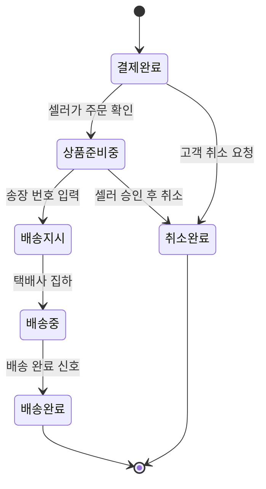
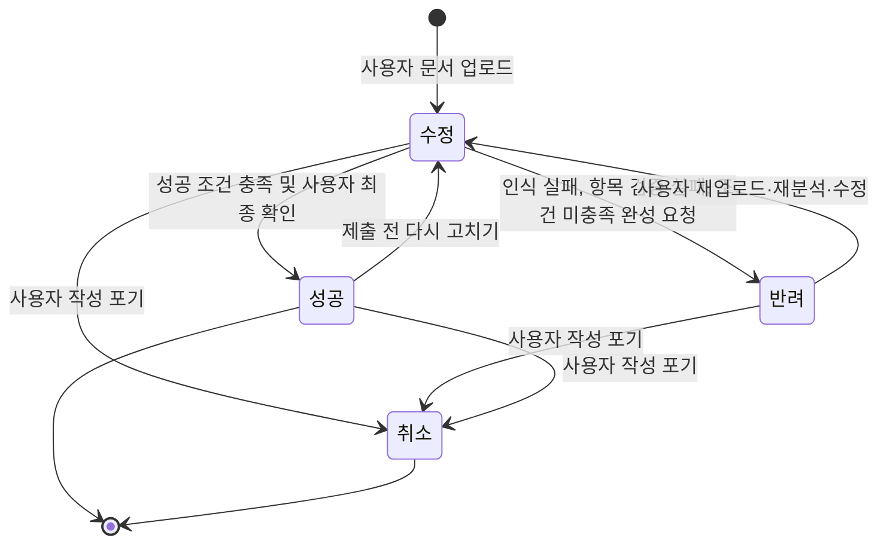

# 3. 규칙, 상태 전이, LLM이 들어갈 자리

> 목표: 클라이언트가 "이 경우엔요?"라고 물을 지점을 우리가 먼저 찾는다. 세부 주제의 필수 조건 두 가지(상태 전이, LLM)가 이 도메인의 어디에 들어갈 수 있는지 찾는다.

## 3-1. 규칙 (최소 5개)

> 규칙은 '항상 / 절대 / ~이면 ~한다' 형태로 씁니다. 예외는 '그런데 만약 ~라면?'으로 찾습니다.
> 예: "배송중이 된 주문은 셀러가 취소할 수 없다" → 만약 고객이 배송중에 취소를 요청하면?

| 번호 | 규칙 | 예외·경계 사례 (만약 ~라면?) | 어기면 생기는 문제         | 태그 | 출처 (카드 번호) |
|----| --- | --- |--------------------|----|---|
| R1 |업로드한 문서는 OCR로 글자와 칸 위치를 먼저 읽고, 문서에 이미 적힌 개인정보를 가린 뒤에만 LLM에 보낸다. 인식에 실패하거나 페이지가 빠졌으면 반려한다. |만약 표·로고처럼 글자만으로는 칸 구성을 읽을 수 없는 문서라면? | 개인정보가 외부 LLM으로 넘어가거나, 칸을 잘못 읽은 채 작성이 진행됨 | 사실, 설계 | C02, 미팅1 Q1·Q4 |
| R2 |LLM이 추론한 입력 항목은 모든 항목에 입력 형식과 필수 여부가 있고 형식이 허용 목록(전화번호, 날짜 등)에 있어야 규칙 검증을 통과한다. 통과한 항목도 사용자가 원본 화면과 나란히 보고 확인해야 확정된다. 검증에 실패하면 반려한다. |만약 외국인 이름·외국인등록번호처럼 허용 목록에 없는 형식이 필요하다면? | 잘못된 칸에 잘못된 형식으로 쓰도록 안내됨 | 설계 | - |
| R3 |필수 항목 누락, 입력 형식 오류, 사전 정보와의 불일치는 규칙 엔진이 판정하고, 오류 메시지는 프론트엔드 국제화로 보여 준다. LLM은 오류를 판정하지 않는다. |만약 형식은 맞지만 사전 정보와 값이 다르고, 사용자가 일부러 다르게 쓴 것이라면(예: 이사 전 주소를 적어야 하는 칸)? | 올바른 입력을 오류로 막거나 실제 오류를 놓침 | 사실, 설계 | 미팅1 Q2 |
| R4 |가상 작성 환경에서 쓴 내용은 절대 실제 기관에 전송하지 않는다. |만약 사용자가 가상 작성 환경의 '제출' 버튼을 실제 제출로 착각한다면? | 연습한 내용이 제출됐다고 오해해 실제 신청을 하지 않음 | 설계 | - |
| R5 |단어·문장의 기본 설명은 항상 서버 용어 사전에서 제공한다. 사용자가 '이해하지 못함'을 고를 때만 LLM이 쉬운 풀이를 만들고, AI 풀이임을 표시한다. |만약 용어 사전에 없는 단어라면? 같은 풀이 요청이 반복된다면? | 같은 질문에 다른 설명이 나오거나 LLM 비용이 커짐 | 설계 | 미팅1 피드백3 |
| R6 |서술형 답변 검토 제안은 자동으로 반영하지 않는다. 사용자가 고른 제안만 반영한다. |만약 사용자가 맞춤법 오류 제안을 모두 무시한다면? | 사용자 의도와 다른 답변으로 바뀜 | 설계 | - |
| R7 |서술형 답변에서 개인정보가 감지되면 모달창으로 알리고, 그대로 둘지·지울지·검토에서 뺄지 사용자가 직접 정한다. 결정 전에는 그 답변을 LLM에 보내지 않는다. |만약 개인정보인지 애매한 내용(자녀 병명, 학교 이름 등)이라면? | 사용자가 모르는 사이에 개인정보가 외부로 넘어감 | 설계, 사실 | C02 |
| R8 |개인정보는 작성에 필요한 범위에서만 받는다. 사전 정보 원본은 LLM에 보내지 않고, 본인인증 정보(인증번호·비밀번호)는 받지도 저장하지도 않는다. |만약 이름·전화번호가 하나라도 가려지지 않은 채 남아 있다면? | 개인정보 유출 및 법적 문제 발생 | 사실, 설계 | C02, 미팅1 Q1 |
| R9 |필수 항목이 모두 입력되고, 사전 정보와의 불일치가 0개(또는 사용자가 차이를 확인)이고, 서술형 검토 제안을 확인하고, 감지된 개인정보에 대한 결정이 끝난 뒤 사용자가 완성본을 최종 확인하면 성공으로 바꾼다. 조건이 남은 채 완성을 요청하면 반려한다. |만약 서술형 칸이 없는 문서라면? | 오류가 남은 완성본을 보고 실제 신청서를 씀 | 설계 | - |
| R10 |실제 신청서의 제출과 서명은 항상 사용자가 공식 사이트에서 직접 한다. 서비스는 대신 제출·서명하지 않고, '제출 완료' 표시는 기록으로만 남긴다. |만약 사용자가 서비스에 대신 제출해 달라고 요청한다면? | 사용자 의사와 다른 신청·동의 발생 | 설계 | - |
| R11 |한 번 입력한 사전 정보는 다음 문서에도 쓰고 다시 묻지 않는다. 사전 정보를 고치면 수정 상태의 작성 건은 불일치를 다시 검사한다. |만약 이미 성공한 작성 건이 쓰던 사전 정보(주소 등)가 바뀌었다면? | 바뀐 정보와 다른 완성본으로 실제 신청서를 씀 | 설계 | - |
| R12 |작성 건의 취소는 사용자만 할 수 있고, 취소된 작성 건은 다시 열지 않는다. 다시 쓰려면 새 작성 건을 만든다. |만약 실수로 취소했다면? | 취소된 작성 건의 입력값이 남아 불필요한 개인정보를 보관함 | 설계 | C02 |

## 3-2. 핵심 대상과 상태 전이

> **필수 조건입니다.** 세부 주제에는 상태가 바뀌는 핵심 대상이 반드시 있어야 합니다. 핵심 대상 후보를 찾아 상태를 적습니다.
>
> 기준:
> - 상태가 **4개 이상**이고, 처음 상태에서 끝 상태까지 순서가 있습니다.
> - 정상 경로 말고 **취소·반려·되돌림·실패 경로가 1개 이상** 있습니다.
> - 전이마다 **누가 바꾸는지, 어떤 조건에서 바꾸는지** 적을 수 있습니다.
>
> 도메인별 예시 (그대로 쓰지 말고 조사한 내용으로 바꿉니다):
>
> | 도메인 | 핵심 대상 | 상태 흐름 예시 |
> | --- | --- | --- |
> | 오픈마켓 셀러 운영 백오피스 | 주문 | 결제완료 → 상품준비중 → 배송지시 → 배송중 → 배송완료 (취소요청 → 취소완료, 반품요청 → 반품완료) |
> | 러닝 자세·훈련 코칭 | 주간 훈련 계획 | 계획됨 → 진행중 → 기록 제출 → 피드백 완료 (기록 부족 → 재측정 요청) |
> | 다문화 가정 행정 절차 안내 | 절차 진행 건 | 준비중 → 서류 확인 → 제출 완료 → 처리 완료 (서류 부족 → 보완 요청 → 서류 확인) |

**핵심 대상**: 작성 건 — 사용자가 웹 신청서 화면(PDF·이미지) 하나를 올리면 생기는 작성 한 건

**상태 4개**

| 상태 | 뜻 | 끝 상태인가 |
| --- | --- | --- |
| 수정 | 작성 건이 만들어진 뒤 문서 인식, 입력 항목 확인, 사전 정보 입력, 가상 작성, 검토를 진행하는 상태. 처음 상태 | 아니오 |
| 반려 | 인식 실패, 입력 항목 규칙 검증 실패, 성공 조건 미충족으로 규칙 엔진이 진행을 막은 상태. 반려 사유를 보여 준다 | 아니오 |
| 성공 | 성공 조건(R9)을 모두 채우고 사용자가 완성본을 최종 확인한 상태. 사용자는 완성본을 보며 공식 사이트에서 직접 제출한다 | 예 (제출 전 다시 고치기 가능) |
| 취소 | 사용자가 작성을 포기한 상태 | 예 |

> v1의 '신청 건' 13개 상태(연습환경 검토중, 리허설중, 실전작성중, 보완요청, 승인, 만료됨 등)는 클라이언트 미팅 1 피드백 1·2에 따라 상담원 검수·리허설·결과 통지가 빠지면서 쓰지 않는다. 제안서 v2 §12의 단계(업로드됨 → 인식완료 → 항목확정 → 사전정보입력완료 → 작성중 → 검토완료)는 아래처럼 '수정' 상태 안의 진행 단계로 둔다.

수정 상태 안의 진행 단계 (상태가 아니라 화면에 보여 주는 단계)

| 단계 | 하는 일 | 관련 기능 / LLM | 막히면 |
| --- | --- | --- | --- |
| ① 업로드·인식 | 문서를 올리고 OCR로 글자와 칸 위치를 읽고 개인정보를 가림 | F-01 / - | 인식 실패 → 반려 (R1) |
| ② 입력 항목 확인 | LLM이 추론한 입력 항목을 규칙 검증하고 사용자가 원본과 비교해 확인 | F-02 / L1 | 규칙 검증 실패 → 반려 (R2), 원본과 다름 → 재분석 요청 |
| ③ 사전 정보 입력 | 필요한 사전 정보를 입력하거나 이미 등록된 정보를 불러옴 | F-03 / - | 이미 모두 등록돼 있으면 건너뜀 (R11) |
| ④ 가상 작성 | 가상 작성 환경에서 작성, 불일치 표시, 단어·문장 설명 | F-04, F-05 / L2 | - |
| ⑤ 검토 | 서술형 답변 검토, 개인정보 감지 결정 | F-06, F-07 / L3 | 조건이 남은 채 완성 요청 → 반려 (R9) |

정상 경로

| 지금 상태 | 다음 상태 | 누가 바꾸나 | 조건 | 되돌릴 수 있나 | 태그 |
| --- | --- | --- | --- | --- | --- |
| (신규) | 수정 | 사용자 | PDF·이미지 등 문서 파일 업로드 | 가능, 삭제 | 설계 |
| 수정 | 성공 | 시스템, 사용자 | 규칙 엔진이 성공 조건(R9)을 모두 확인하고 사용자가 완성본을 최종 확인 | 가능, 다시 고치기 | 설계 |

예외·되돌림 경로

| 지금 상태 | 다음 상태 | 누가 바꾸나 | 조건 | 되돌릴 수 있나 | 태그 |
| --- | --- | --- | --- | --- | --- |
| 수정 | 반려 | 시스템 (규칙 엔진) | OCR 인식 실패·페이지 누락(R1), LLM이 추론한 입력 항목의 규칙 검증 실패(R2), 성공 조건이 남은 채 완성 요청(R9) 중 하나 | 가능 | 설계 |
| 반려 | 수정 | 사용자 | 반려 사유를 확인하고 재업로드·재분석 요청·입력 수정 중 하나를 시작 | 가능 | 설계 |
| 성공 | 수정 | 사용자 | 제출 전에 고칠 내용을 발견했거나 이 작성 건이 쓰는 사전 정보를 고침(R11) | 가능 | 설계 |
| 수정·반려·성공 | 취소 | 사용자 | 작성 포기 선택 | 불가, 새 작성 건 생성 (R12) | 설계 |

> 표를 다 채우면 아래처럼 그림으로도 그립니다. GitHub는 `mermaid` 코드 블록을 그림으로 보여 줍니다. 예시의 상태 이름과 화살표를 우리 내용으로 바꿉니다. 미리 보기는 GitHub의 파일 화면이나 편집 화면의 **Preview** 탭에서 확인합니다.

## 3-3. 시간에 따라 달라지는 규칙

> 기한, 마감, 주말·공휴일, 유효기간처럼 시간이 끼는 규칙을 1개 이상 적습니다. 3-2의 상태 전이와 이어지면 더 좋습니다.
> 예: 결제 후 ○영업일 안에 배송지시가 없으면 지연으로 표시한다 / 체류 기간 만료 ○일 전부터 연장 신청을 할 수 있다

| 규칙                                       | 기준 시간 | 주말·공휴일이면? | 태그 | 출처 (카드 번호) |
|------------------------------------------| --- | --- |----| --- |
| T1. 문서에 신청 마감일과 시각이 적혀 있으면 작성 건에 함께 보여 주고, 적혀 있지 않으면 임의로 정하지 않고 공식 신청처에 확인하도록 안내한다. 마감일이 지나도 작성 건의 상태는 바꾸지 않는다. | 문서에 적힌 신청 마감일·시각 | 문서에 적힌 날짜를 우선 적용 | 설계 | - |
| T2. 기간의 마지막 날이 토요일이나 공휴일이면 해당 기간에 적용되는 법령과 공고문을 확인하도록 안내하고, 임의로 마감일을 연장해 보여 주지 않는다. | 법령상 기간의 말일 | 민법 제161조 적용 여부를 검토하고 임의로 마감일을 연장하지 않음 | 사실, 설계 | C04 |
| T3. 작성 건이 취소로 바뀌면 그 작성 건의 업로드 문서와 입력값은 처리 목적이 끝난 것으로 보고 삭제한다. 사전 정보는 다른 문서에도 쓰므로 사용자가 지울 때까지 남긴다. | 취소로 바뀐 시점 | 주말·공휴일 관계없이 적용 | 사실, 설계 | C02 |
| T4. LLM 검토를 위해 보낸 서술형 답변과 개인정보 감지 결과 같은 임시 데이터는 처리 목적이 끝나면 삭제한다. | 처리 목적 달성 시점 | 주말·공휴일 관계없이 적용 | 사실, 설계 | C02 |

## 3-4. LLM이 들어갈 자리

> **필수 조건입니다.** 세부 주제에는 LLM이 **서비스 기능 안에서** 쓰여야 합니다. 개발할 때 Claude를 쓰는 것은 여기에 해당하지 않습니다. 사용자가 서비스를 쓰는 동안 LLM이 무엇을 해 주는지 찾습니다.
>
> 좋은 자리를 고르는 기준:
> - 지금 사람이 **글을 읽고 쓰거나, 설명을 바꾸거나, 분류하는 데** 시간이 드는 곳 (2-2 As-Is의 문제 지점)
> - LLM이 틀려도 **사람이 확인하거나 규칙으로 걸러 낼 수 있는** 곳
> - 상태를 바꾸는 최종 결정은 **규칙이나 사람**이 하고, LLM은 초안·요약·분류·설명을 맡습니다
>
> 도메인별 예시:
>
> | 도메인 | LLM이 하는 일 | 사람이 확인하는 곳 |
> | --- | --- | --- |
> | 오픈마켓 셀러 운영 백오피스 | 고객 문의를 읽고 유형(취소·반품·배송 문의)을 분류하고 답변 초안 작성 | CS 담당이 고쳐서 보냄. 취소·반품 상태 변경은 규칙대로 |
> | 러닝 자세·훈련 코칭 | 러너가 남긴 훈련 기록과 느낌을 요약하고 다음 주 조정 제안 작성 | 코치가 승인해야 계획에 반영. 통증 언급은 의료 상담 권유로 |
> | 다문화 가정 행정 절차 안내 | 공식 안내문을 이용자의 언어와 쉬운 말로 바꾸고, 필요한 서류 목록을 뽑기 | 상담원이 원문과 비교해 확인. 법적 판단은 하지 않음 |

> v1의 L1~L7 중 규칙 엔진과 프론트엔드 국제화로 할 수 있는 곳(오류 설명, 모국어 코치, 위기 상황 생성, 주의 조항 요약, 결과 통지 분석, 실전 내비게이터)은 클라이언트 미팅 1 피드백 3에 따라 빼고, 문서마다 달라 규칙으로 정할 수 없는 3곳만 남겼다.

| 후보 | LLM에 넣는 것 (입력) | LLM이 내놓는 것 (출력) | 누가 보고 확인하나 | 틀리면 생기는 일 | 이어지는 상태 전이 | LLM에 보내면 안 되는 정보 |
| --- | --- | --- | --- | --- | --- | --- |
| L1. 입력 항목 추론 | 개인정보를 가린 OCR 텍스트, 칸 위치와 라벨, 사용 언어 | 입력 항목 목록(항목명, 연결할 사전 정보, 입력 형식, 필수 여부, 모국어 설명) | 규칙 엔진(형식·필수 여부 검증) + 사용자(원본 화면과 나란히 확인) | 잘못된 칸에 잘못된 정보나 형식을 쓰게 됨 | 수정 유지. 규칙 검증에 실패하면 규칙 엔진이 수정 → 반려 | 문서에 이미 적힌 이름·주민등록번호·외국인등록번호·연락처 등 개인정보 (OCR 단계에서 가림) |
| L2. 모국어 쉬운 풀이 | 사용자가 고른 단어·문장, 서버 용어 사전의 기본 설명, 문서 종류, 사용 언어 | 모국어·쉬운 한국어 풀이와 예시 문장 | 사용자. 자주 요청되는 풀이는 팀이 검토해 용어 사전에 추가 | 뜻을 잘못 이해한 채 답을 고름 | 상태를 바꾸지 않음 (수정 유지) | 사용자가 입력한 값, 사전 정보 |
| L3. 서술형 답변 검토 | 질문(칸 제목·안내 문구), 개인정보 감지 단계를 거친 사용자 답변, 사용 언어 | 맞춤법·문법 수정 제안, 질문 의도에 맞는지 판단, 보충할 내용 제안 (모국어 설명 포함) | 사용자가 제안마다 반영할지 직접 고름 (R6) | 질문 의도와 다른 답을 그대로 내거나 잘못 고침 | 수정 유지. 사용자가 제안을 확인하면 수정 → 성공 조건(R9) 하나가 채워짐 | 개인정보 감지 모달에서 사용자가 보내지 않기로 한 내용, 사전 정보 원본 |

## 3-5. 법령·통계·보고서로 확인하기

> 팀 합계 3개 이상. 3-1 규칙과 ⑤ 손해처럼 근거가 약한 내용을 자료로 확인합니다. 이 중 1개 이상은 `[추정]`·`[가정]`을 `[사실]`로 바꾸거나, 반대로 틀렸다는 것을 확인한 것이어야 합니다.
> 자료마다 [카드](cards/_template.md)를 한 장씩 만들고, 여기에는 목록만 적습니다. 조항 번호나 숫자는 카드에 자료에 적힌 그대로 옮깁니다.

| 자료 종류 | 카드 번호 | 자료명 (짧게) | 확인한 내용 요지 | 태그 변화 | 반영한 표 |
| --- | --- | --- | --- | --- | --- |
| 법령 | C01 | 다문화가족지원법 제6·11·12조 | 생활정보·교육 지원, 다국어 서비스 제공 노력, 가족센터의 교육·상담·통번역 지원 업무가 법률에 규정되어 있음. | 추정 → 사실 | 3-4 L1·L2 (다국어 지원 관련 배경) |
| 법령 | C02 | 개인정보 보호법 제15·16·17·21조 | 개인정보의 적법한 수집·이용, 최소 수집, 제3자 제공 요건, 불필요해진 개인정보의 파기 원칙을 확인함. | 추정 → 사실 | 3-1 R1·R7·R8·R12, 3-3 T3·T4, 3-4 개인정보 관련 항목 |
| 법령 | C03 | 민원 처리에 관한 법률 제8·9·22조 | 문서·전자문서에 의한 민원 신청, 접수 절차, 보완·변경·취하 관련 규정 및 예외를 확인함. | 추정 → 사실 | v1의 제출·보완 경로에 반영했으나, v2에서 제출 이후 결과 통지 관리가 범위 밖이 되어 현재 표에는 반영하지 않음 |
| 법령 | C04 | 민법 제155·161조 | 기간 계산에 다른 정함이 있을 수 있으며, 토요일·공휴일의 기간 만료 규정이 있음을 확인함. 모든 공고 마감이 자동 연장되는 것은 아님. | 가정 → 사실 (법정 기간 규정에 한함) | 3-3 T2 |
| 통계·보고서 | C05 | 2025 디지털정보격차 실태조사 | 결혼이민자 700명을 조사 대상으로 포함. 결혼이민자의 디지털정보화 종합 수준은 일반국민 대비 95.1%, 접근 수준 101.7%, 역량 수준 90.0%로 제시됨. | 추정 → 사실 (디지털 역량 격차 존재) | 3-4 L2 (서비스 필요성 배경) |
