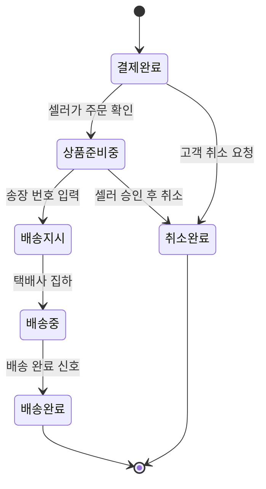
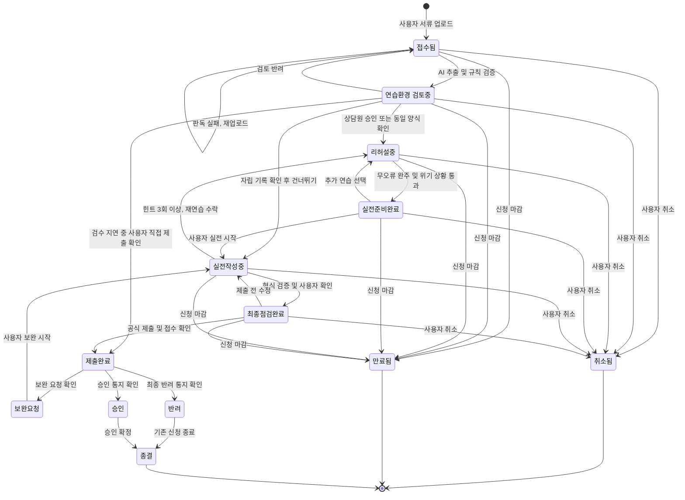

# 3. 규칙, 상태 전이, LLM이 들어갈 자리

> 목표: 클라이언트가 "이 경우엔요?"라고 물을 지점을 우리가 먼저 찾는다. 세부 주제의 필수 조건 두 가지(상태 전이, LLM)가 이 도메인의 어디에 들어갈 수 있는지 찾는다.

## 3-1. 규칙 (최소 5개)

> 규칙은 '항상 / 절대 / ~이면 ~한다' 형태로 씁니다. 예외는 '그런데 만약 ~라면?'으로 찾습니다.
> 예: "배송중이 된 주문은 셀러가 취소할 수 없다" → 만약 고객이 배송중에 취소를 요청하면?

| 번호 | 규칙 | 예외·경계 사례 (만약 ~라면?) | 어기면 생기는 문제         | 태그 | 출처 (카드 번호) |
|----| --- | --- |--------------------|----|---|
| R1 |AI가 추출한 모든 입력 항목에 입력 유형과 필수 여부가 지정되고, 판독에 실패한 페이지가 없으면 연습환경 검토중 상태로 전환한다. |만약 일부 페이지를 인식하지 못했다면? | 필수 항목이 누락된 가상 신청서로 연습하여 실제 신청에서 오류 발생 | 설계 | - |
| R2 |AI가 생성한 가상 신청서는 상담원의 승인을 받은 뒤 리허설에 사용한다. 단, 이전에 승인된 양식과 버전 및 핵심 입력 항목이 동일하면 시스템이 자동 승인할 수 있다. |만약 동일한 양식이지만 필수 항목이나 제출 서류가 변경되었다면? | 잘못된 양식으로 연습하여 실제 신청에서 오류 발생 | 설계, 가정 | - |
| R3 |리허설에서 입력한 내용은 절대 실제 기관에 제출하지 않는다. |만약 사용자가 연습 중 제출 버튼을 누른다면? | 연습 데이터가 실제 신청으로 접수되는 문제 | 설계 | - |
| R4 |필수 항목이 누락되거나 입력 형식이 잘못되면 오류로 판정하고 수정 방법을 안내한다. 오류 판정은 규칙 엔진이 담당한다. |만약 외국인등록번호나 외국인 이름 등 특수 형식이 필요하다면? | 올바른 입력을 잘못된 것으로 판단하거나 오류를 놓침 | 설계 | - |
| R5 |필수 항목 오류 0개로 리허설 1회 완주하고 위기 상황 1회를 통과하면 실전준비완료로 변경한다. |만약 필수 항목은 모두 맞았지만 본인인증 실패 상황을 해결하지 못했다면? | 실제 신청 중 문제가 발생했을 때 대응하지 못함 | 설계 | - |
| R6 |실제 신청서의 제출과 서명은 항상 사용자가 직접 수행한다. AI는 절대 대신 제출하거나 서명하지 않는다. |만약 사용자가 AI에게 대신 신청해 달라고 요청한다면? | 사용자 의사와 다른 신청·동의 발생 | 설계 | - |
| R7 |중요한 계약 조항과 개인정보 제공 동의 항목은 사용자가 직접 확인해야 한다. |만약 사용자가 동의하지 않는다면? | 불필요한 개인정보 제공이나 원하지 않는 계약 체결 | 설계 | C02 |
| R8 |개인정보는 필요한 범위에서만 수집하며, 상담원이나 외부 서비스에 제공할 때는 적법한 근거를 확인한다. |만약 신청서에 주민등록번호·연락처 등 민감한 식별정보가 포함되어 있다면? | 개인정보 유출 및 법적 문제 발생 | 설계, 사실 | C02 |
| R9 |사용자가 공식 신청 경로에서 직접 제출하고 접수번호·접수증·제출 완료 화면 등으로 제출 사실을 확인하면 제출완료 상태로 변경한다. |만약 접수번호가 제공되지 않는 신청이라면? 제출 여부가 불확실하면? | 제출되지 않은 신청을 완료된 것으로 잘못 표시하거나 정상적으로 제출된 신청을 미제출로 판단할 수 있음 | 설계 | - |
| R10 |공식 신청 마감일이 지나고 제출이 확인되지 않은 신청 건은 만료 처리한다. |만약 기관에서 마감일을 연장했거나 제출 증빙이 늦게 등록되었다면? | 신청 기회 상실 또는 정상 신청의 잘못된 만료 처리 | 설계 | - |
| R11 |승인·반려 등의 처리 결과는 공식 통지 내용을 사용자가 확인한 뒤 확정한다. |만약 AI가 반려라고 분석했지만 실제로는 서류 보완 요청이라면? | 신청 결과 오판 및 불필요한 재신청 | 설계 | C03 |
| R12 |이전에 동일 유형의 신청을 힌트 없이 완주한 기록이 있고 현재 양식의 핵심 입력 항목과 절차가 동일하면 리허설 건너뛰기를 제안한다. |만약 같은 신청 유형이지만 양식이나 제출 절차가 변경되었다면? | 변경된 양식을 충분히 확인하지 않아 실제 신청에서 오류 발생 | 설계 | - |
| R13 |신청 마감이 임박했지만 연습 환경 검수가 완료되지 않았다면 공식 신청 경로와 상담 방법을 우선 안내한다. 검수되지 않은 연습 환경을 승인된 것으로 표시하지 않는다. |만약 상담원 부재로 마감 전 검수가 불가능하다면? | 연습 환경 승인 대기로 인해 실제 신청 기회를 놓칠 수 있다. | 설계 | - |

## 3-2. 핵심 대상과 상태 전이

> **필수 조건입니다.** 세부 주제에는 상태가 바뀌는 핵심 대상이 반드시 있어야 합니다. 핵심 대상 후보를 찾아 상태를 적습니다.
>
> 기준:
> - 상태가 **4개 이상**이고, 처음 상태에서 끝 상태까지 순서가 있습니다.
> - 정상 경로 말고 **취소·반려·되돌림·실패 경로가 1개 이상** 있습니다.
> - 전이마다 **누가 바꾸는지, 어떤 조건에서 바꾸는지** 적을 수 있습니다.
>
> 도메인별 예시 (그대로 쓰지 말고 조사한 내용으로 바꿉니다):
>
> | 도메인 | 핵심 대상 | 상태 흐름 예시 |
> | --- | --- | --- |
> | 오픈마켓 셀러 운영 백오피스 | 주문 | 결제완료 → 상품준비중 → 배송지시 → 배송중 → 배송완료 (취소요청 → 취소완료, 반품요청 → 반품완료) |
> | 러닝 자세·훈련 코칭 | 주간 훈련 계획 | 계획됨 → 진행중 → 기록 제출 → 피드백 완료 (기록 부족 → 재측정 요청) |
> | 다문화 가정 행정 절차 안내 | 절차 진행 건 | 준비중 → 서류 확인 → 제출 완료 → 처리 완료 (서류 부족 → 보완 요청 → 서류 확인) |

**핵심 대상 후보**: 신청 건

정상 경로

| 지금 상태 | 다음 상태 | 누가 바꾸나 | 조건 | 되돌릴 수 있나 | 태그 |
| --- | --- | --- | --- | --- | --- |
| 신규 | 접수됨 | 사용자 | 신청서·공고문 등을 업로드 | 가능, 삭제 | 설계 |
| 접수됨 | 연습환경 검토중 | 시스템 | AI 추출 완료 및 입력 항목의 구조·형식 검증 통과 | 가능 | 설계 |
| 연습환경 검토중 | 리허설중 | 센터 상담원 또는 시스템 | 상담원 승인 또는 동일 버전의 승인된 양식 확인 | 가능, 재검토 | 설계, 가정 |
| 리허설중 | 실전준비완료 | 시스템 | 필수 항목 오류 0개로 1회 완주 및 위기 상황 1회 통과 | 가능, 재연습 | 설계 |
| 실전준비완료 | 실전작성중 | 사용자 | 실전 시작 버튼 선택 | 가능 | 설계 |
| 실전작성중 | 최종점검완료 | 시스템, 사용자 | 확인 가능한 필수 항목·형식 검증 통과 및 주의 조항 직접 확인 | 가능, 수정 | 설계 |
| 최종점검완료 | 제출완료 | 사용자 | 공식 신청 경로에서 직접 제출하고 접수증·제출 완료 화면 등으로 제출 사실 확인 | 내부 제출 기록 정정 가능 | 설계 |
| 제출완료 | 승인 | 사용자 | 공식 승인 통지 등록 및 확인 | 오입력 정정 가능 | 설계 |
| 제출완료 | 반려 | 사용자 | 공식 최종 반려 통지 등록 및 확인 | 오입력 정정 가능 | 설계 |
| 승인 | 종결 | 시스템 | 승인 결과 확정 | 원칙적으로 종료 | 설계 |
| 반려 | 종결 | 사용자 | 최종 반려 확인 후 기존 신청 건 종료 선택 | 새 신청 건 생성 가능 | 설계 |
예외·되돌림 경로

| 지금 상태 | 다음 상태 | 누가 바꾸나 | 조건 | 되돌릴 수 있나 | 태그 |
| --- | --- | --- | --- | --- | --- |
| 접수됨 | 접수됨 | 시스템 | 서류 인식 실패 또는 페이지 누락으로 재업로드 요청 | 가능 | 설계 |
| 연습환경 검토중 | 접수됨 | 상담원 | 추출 항목 오류 발견 및 수정·재검토 요청 | 가능 | 설계, 가정 |
| 연습환경 검토중 | 제출완료 | 사용자 | 검수 지연으로 리허설을 진행하지 못했지만 사용자가 공식 기관에서 직접 신청서를 제출하고 제출 사실을 확인한 경우 | 내부 제출 기록 정정 가능 | 설계 |
| 실전작성중 | 리허설중 | 사용자 | 동일 단계에서 힌트 3회 이상 요청 후 재연습 제안 수락 | 가능 | 설계 |
| 실전준비완료 | 리허설중 | 사용자 | 실전 시작 전 추가 연습 선택 | 가능 | 설계 |
| 연습환경 검토중 | 실전작성중 | 시스템, 사용자 | 승인된 양식과 현재 양식의 핵심 항목·절차가 동일하고, 이전에 해당 유형을 힌트 없이 완주한 기록이 있을 때 사용자가 건너뛰기 선택 | 가능 | 설계 |
| 최종점검완료 | 실전작성중 | 사용자 | 제출 전 입력 오류나 수정할 내용을 발견한 경우 | 가능 | 설계 |
| 제출완료 | 보완요청 | 사용자 | 기관의 공식 보완 요청 확인 | 가능 | 설계 |
| 보완요청 | 실전작성중 | 사용자 | 보완할 항목을 확인하고 수정 시작 | 가능 | 설계 |
| 제출 전 모든 상태 | 취소됨 | 사용자 | 신청 포기 선택 | 새 신청 건 생성 가능 | 설계 |
| 제출 전 모든 상태 | 만료됨 | 시스템 | 공식 마감 시각 경과 및 제출 사실 없음 | 마감 연장 확인 시 재개 가능 | 설계 |

> 표를 다 채우면 아래처럼 그림으로도 그립니다. GitHub는 `mermaid` 코드 블록을 그림으로 보여 줍니다. 예시의 상태 이름과 화살표를 우리 내용으로 바꿉니다. 미리 보기는 GitHub의 파일 화면이나 편집 화면의 **Preview** 탭에서 확인합니다.

## 3-3. 시간에 따라 달라지는 규칙

> 기한, 마감, 주말·공휴일, 유효기간처럼 시간이 끼는 규칙을 1개 이상 적습니다. 3-2의 상태 전이와 이어지면 더 좋습니다.
> 예: 결제 후 ○영업일 안에 배송지시가 없으면 지연으로 표시한다 / 체류 기간 만료 ○일 전부터 연장 신청을 할 수 있다

| 규칙                                       | 기준 시간 | 주말·공휴일이면? | 태그 | 출처 (카드 번호) |
|------------------------------------------| --- | --- |----| --- |
| T1. 서류에 신청 마감일과 시각이 명시되지 않았다면 임의로 지정하지 않고 공식 신청처에 확인하도록 안내하고 시각이 명시되어 있으면 해당 정보를 신청 건에 등록한다. | 공식 공고문의 신청 마감일·시각 | 공고문에 명시된 날짜를 우선 적용 | 설계 | - |
| T2. 제출하지 않은 신청 건은 마감일 D-7, D-1에 알림을 보낸다. | 마감 7일 전, 1일 전 | 주말·공휴일에도 알림 발송 | 설계 | - |
| T3. 공식 마감 날짜와 시각이 확인되고, 해당 시각이 지났으며 제출 사실이 확인되지 않은 경우 신청 건을 만료 처리한다. | 공식 신청 마감 시각 | 기관의 마감 연장 공고가 있다면 갱신 | 설계 | C04 |
| T4. 기간의 마지막 날이 토요일이나 공휴일이면 해당 기간에 적용되는 법령과 공고문을 확인한다. | 법령상 기간의 말일 | 민법 제161조 적용 여부를 검토하고 임의로 마감일을 연장하지 않음 | 사실, 설계 | C04 |
| T5. 결과 발표 예정일이 지나도 결과가 등록되지 않았다면 공식 결과 확인을 안내한다. | 기관의 결과 발표 예정일 | 기관의 발표 일정 변경 여부 확인 | 설계 | - |
| T6. 실전 화면에서 수집한 임시 개인정보는 처리 목적이 끝나면 삭제한다. | 처리 목적 달성 시점 | 주말·공휴일 관계없이 적용 | 사실, 설계 | C02 |

## 3-4. LLM이 들어갈 자리

> **필수 조건입니다.** 세부 주제에는 LLM이 **서비스 기능 안에서** 쓰여야 합니다. 개발할 때 Claude를 쓰는 것은 여기에 해당하지 않습니다. 사용자가 서비스를 쓰는 동안 LLM이 무엇을 해 주는지 찾습니다.
>
> 좋은 자리를 고르는 기준:
> - 지금 사람이 **글을 읽고 쓰거나, 설명을 바꾸거나, 분류하는 데** 시간이 드는 곳 (2-2 As-Is의 문제 지점)
> - LLM이 틀려도 **사람이 확인하거나 규칙으로 걸러 낼 수 있는** 곳
> - 상태를 바꾸는 최종 결정은 **규칙이나 사람**이 하고, LLM은 초안·요약·분류·설명을 맡습니다
>
> 도메인별 예시:
>
> | 도메인 | LLM이 하는 일 | 사람이 확인하는 곳 |
> | --- | --- | --- |
> | 오픈마켓 셀러 운영 백오피스 | 고객 문의를 읽고 유형(취소·반품·배송 문의)을 분류하고 답변 초안 작성 | CS 담당이 고쳐서 보냄. 취소·반품 상태 변경은 규칙대로 |
> | 러닝 자세·훈련 코칭 | 러너가 남긴 훈련 기록과 느낌을 요약하고 다음 주 조정 제안 작성 | 코치가 승인해야 계획에 반영. 통증 언급은 의료 상담 권유로 |
> | 다문화 가정 행정 절차 안내 | 공식 안내문을 이용자의 언어와 쉬운 말로 바꾸고, 필요한 서류 목록을 뽑기 | 상담원이 원문과 비교해 확인. 법적 판단은 하지 않음 |

| 후보 | LLM에 넣는 것 (입력) | LLM이 내놓는 것 (출력) | 누가 보고 확인하나 | 틀리면 생기는 일 | 이어지는 상태 전이 | LLM에 보내면 안 되는 정보 |
| --- | --- | --- | --- | --- | --- | --- |
| L1. 서류 분석 및 가상 신청서 생성 | 개인정보를 제거한 신청서·공고문 내용 | 입력 항목, 필수 여부, 입력 형식, 마감일, 필요 서류를 정리한 가상 신청서 초안 | 규칙 엔진 + 센터 상담원 | 필수 항목 누락 및 잘못된 연습 환경 생성 | 접수됨 → 연습환경 검토중 → 리허설중 | 불필요한 주민등록번호, 외국인등록번호, 실제 계좌번호 |
| L2. 모국어 AI 코치 | 현재 입력 항목, 사용 언어, 이해하지 못한 용어 | 모국어와 쉬운 한국어로 작성 방법 설명 및 음성 안내 | 사용자 | 잘못된 의미 이해로 신청서 오작성 | 리허설중 유지 | 비밀번호, 인증번호, 불필요한 개인 신상정보 |
| L3. 실시간 오류 설명 | 규칙 엔진이 발견한 입력 오류 종류, 항목명, 형식 규칙 | 오류가 발생한 이유와 올바른 수정 방법 | 사용자 + 규칙 엔진 | 잘못된 수정 안내로 오류 반복 | 리허설중 → 실전준비완료 | 실제 입력값 중 설명에 필요 없는 개인정보 |
| L4. 위기 상황 연습 생성 | 신청서 유형, 현재 진행 단계, 돌발 상황 종류 | 본인인증 실패, 첨부 오류 등의 가상 시나리오 및 대처 안내 | 규칙 엔진 + 사용자 | 잘못된 대처법 학습 | 리허설중 → 실전준비완료 | 실제 인증 문자, 일회용 비밀번호, 로그인 정보 |
| L5. 제출 전 주의 조항 요약 | 개인정보를 제거한 계약서·동의서 내용 | 위약금, 자동 갱신, 개인정보 제공 등의 주의 조항 요약과 원문 위치 | 사용자 | 중요한 조항을 놓치거나 의미를 잘못 이해함 | 실전작성중 → 최종점검완료 | 주민등록번호, 서명 이미지, 불필요한 계약 당사자 개인정보 |
| L6. 결과 통지 분석 | 개인정보를 제거한 공식 승인·반려·보완 요청 통지 내용 | 결과 유형 분류 초안, 반려 사유 및 보완 항목 정리 | 사용자 | 결과를 잘못 분류하거나 필요한 보완을 놓침 | 제출완료 → 승인·반려·보완요청 | 접수번호 전체 등 분석에 불필요한 식별정보 |
| L7. 실전 작성 내비게이터 | 개인정보를 제거한 현재 화면의 텍스트, 승인된 신청서 항목 정보, 이전 연습 기록 | 현재 작성 단계와 다음에 입력할 항목에 대한 모국어·쉬운 한국어 안내 | 사용자 | 잘못된 입력 위치 안내로 신청 내용이 누락되거나 잘못 작성될 수 있음 | 실전작성중 유지 → 규칙 검증 및 사용자 확인 후 최종점검완료 | 비밀번호, 인증번호, 주민등록번호 등 안내에 불필요한 개인정보 |

## 3-5. 법령·통계·보고서로 확인하기

> 팀 합계 3개 이상. 3-1 규칙과 ⑤ 손해처럼 근거가 약한 내용을 자료로 확인합니다. 이 중 1개 이상은 `[추정]`·`[가정]`을 `[사실]`로 바꾸거나, 반대로 틀렸다는 것을 확인한 것이어야 합니다.
> 자료마다 [카드](cards/_template.md)를 한 장씩 만들고, 여기에는 목록만 적습니다. 조항 번호나 숫자는 카드에 자료에 적힌 그대로 옮깁니다.

| 자료 종류 | 카드 번호 | 자료명 (짧게) | 확인한 내용 요지 | 태그 변화 | 반영한 표 |
| --- | --- | --- | --- | --- | --- |
| 법령 | C01 | 다문화가족지원법 제6·11·12조 | 생활정보·교육 지원, 다국어 서비스 제공 노력, 가족센터의 교육·상담·통번역 지원 업무가 법률에 규정되어 있음. | 추정 → 사실 | 3-4 L1·L2 (다국어 지원 관련 배경) |
| 법령 | C02 | 개인정보 보호법 제15·16·17·21조 | 개인정보의 적법한 수집·이용, 최소 수집, 제3자 제공 요건, 불필요해진 개인정보의 파기 원칙을 확인함. | 추정 → 사실 | 3-1 R7·R8, 3-3 T6, 3-4 개인정보 관련 항목 |
| 법령 | C03 | 민원 처리에 관한 법률 제8·9·22조 | 문서·전자문서에 의한 민원 신청, 접수 절차, 보완·변경·취하 관련 규정 및 예외를 확인함. | 추정 → 사실 | 3-2 제출·보완 경로, 3-4 L6 |
| 법령 | C04 | 민법 제155·161조 | 기간 계산에 다른 정함이 있을 수 있으며, 토요일·공휴일의 기간 만료 규정이 있음을 확인함. 모든 공고 마감이 자동 연장되는 것은 아님. | 가정 → 사실 (법정 기간 규정에 한함) | 3-3 T4 |
| 통계·보고서 | C05 | 2025 디지털정보격차 실태조사 | 결혼이민자 700명을 조사 대상으로 포함. 결혼이민자의 디지털정보화 종합 수준은 일반국민 대비 95.1%, 접근 수준 101.7%, 역량 수준 90.0%로 제시됨. | 추정 → 사실 (디지털 역량 격차 존재) | 3-4 L2·L4 (서비스 필요성 배경) |
